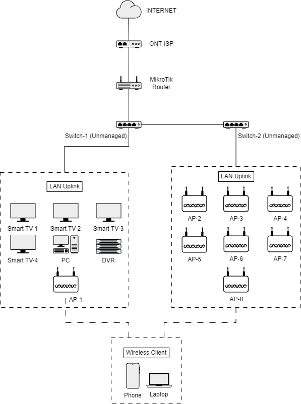

# Dokumentasi Infrastruktur Jaringan Lokal & Sistem Pengawasan

Dokumentasi ini memaparkan rancangan arsitektur jaringan, pembagian perangkat, serta studi kasus *troubleshooting* pada infrastruktur jaringan lokal berbasis **MikroTik RouterOS**.

## 1. Diagram Topologi Jaringan

## 2. Spesifikasi & Peran Perangkat

| Perangkat | Jumlah | Tipe Koneksi | Peran & Fungsi Utama |
| :--- | :---: | :--- | :--- |
| **ONT ISP** | 1 Unit | Fiber Optic / LAN | Terminasi jalur internet dari penyedia layanan (*uplink* WAN). |
| **MikroTik Router (PC x86)** | 1 Unit | Kabel LAN | *Gateway* utama, DHCP Server, NAT, Firewall, dan manajemen *bandwidth* (QoS). |
| **Unmanaged Switch** | 2 Unit | Kabel LAN | Distribusi koneksi Layer 2 (*Switch-1* untuk perangkat tetap, *Switch-2* untuk jalur *uplink* Wi-Fi). |
| **Access Point (AP-1 – AP-8)** | 8 Unit | Kabel LAN (Uplink) | Pemancar jaringan nirkabel (*WLAN*) untuk pemerataan jangkauan sinyal di seluruh area. |
| **DVR CCTV (16-Channel)** | 1 Unit | Kabel LAN | Sistem perekaman video 24/7 dan pemantauan kamera keamanan lokal/jarak jauh. |
| **Smart TV (TV-1 – TV-4)** | 4 Unit | Kabel LAN | Perangkat *streaming* multimedia yang dialokasikan jalur kabel agar sinyal Wi-Fi tidak terbebani. |
| **Desktop PC** | 1 Unit | Kabel LAN | Komputer kerja utama dan pusat administrasi jaringan (WinBox). |
| **Wireless Clients** | Multi-user | Wi-Fi (DHCP) | Perangkat *smartphone* dan laptop yang terhubung melalui titik akses `AP-1` hingga `AP-8`. |

## 3. Arsitektur & Manajemen Trafik

* **Sentralisasi Kendali pada MikroTik:** Karena lapisan distribusi menggunakan dua buah *unmanaged switch* (*plug-and-play*), seluruh kendali logis—mulai dari alokasi IP (DHCP), pemetaan *Static Lease* untuk perangkat penting (DVR & Access Point), hingga aturan keamanan—dipusatkan di **MikroTik Router**.
* **Pemisahan Beban (*Cascading Switch*):** **Switch-1** melayani perangkat berbasis kabel yang membutuhkan konektivitas stabil (`Smart TV 1–4`, `PC`, `DVR`, dan `AP-1`), sedangkan **Switch-2** terhubung secara berantai untuk menyuplai jalur *uplink* kabel bagi `AP-2` hingga `AP-8`.
* **Optimasi Bandwidth & Sinyal Nirkabel:** Menerapkan pembatasan dan prioritas trafik (*Simple Queue*) agar aktivitas *streaming* resolusi tinggi pada 4 Smart TV tidak mengganggu latensi pada PC utama maupun akses DVR.

## 4. Studi Kasus *Troubleshooting*
